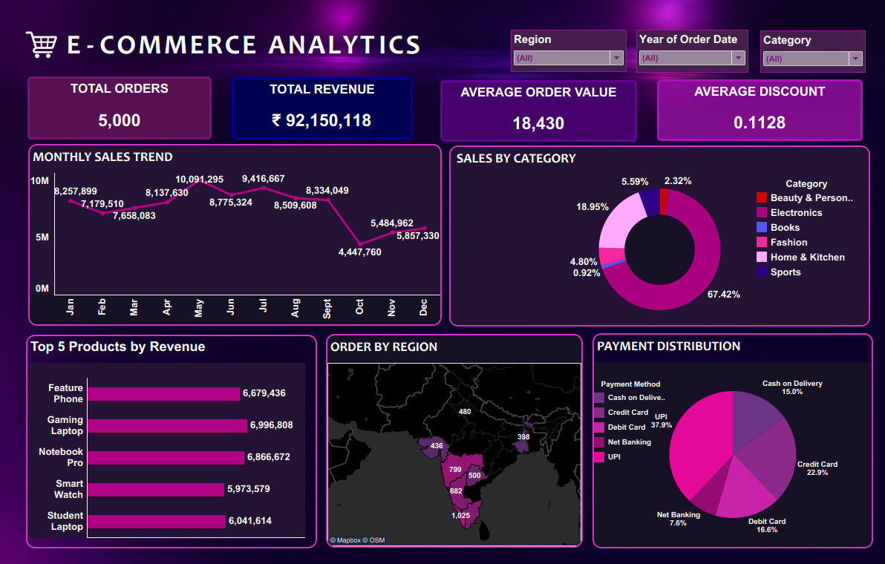

# E-commerce Analytics Dashboard – Tableau

## Project Overview
This project focuses on analyzing e-commerce business performance using Tableau. The dashboard provides insights into sales, profit, customer behavior, product performance, and regional trends.

## Tools Used
- Tableau
- Microsoft Excel
- Data Visualization

## Key Analysis
- Sales Performance Analysis
- Profit Analysis
- Customer Segmentation
- Product Category Analysis
- Regional Sales Performance
- Order Trends

## Project Objective
To transform e-commerce data into meaningful business insights through interactive Tableau visualizations and dashboards.

## Project Files
- Tableau workbook – Interactive Dashboard
- Dashboard screenshots – Visual previews
  
## Dashboard Preview

